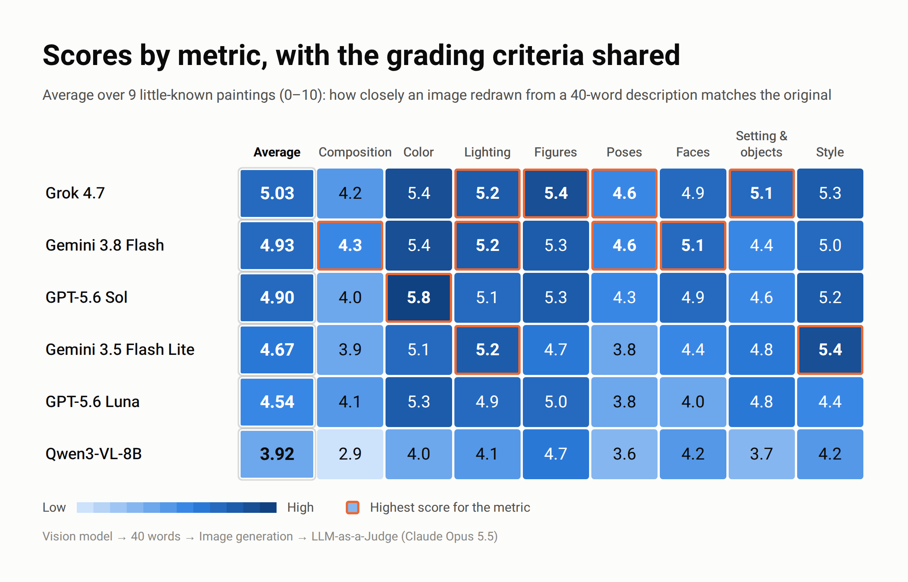
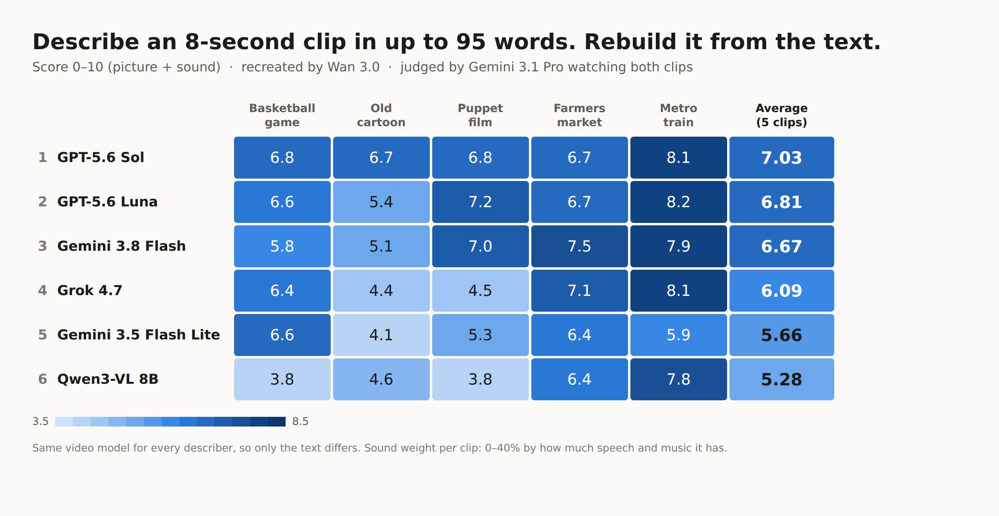
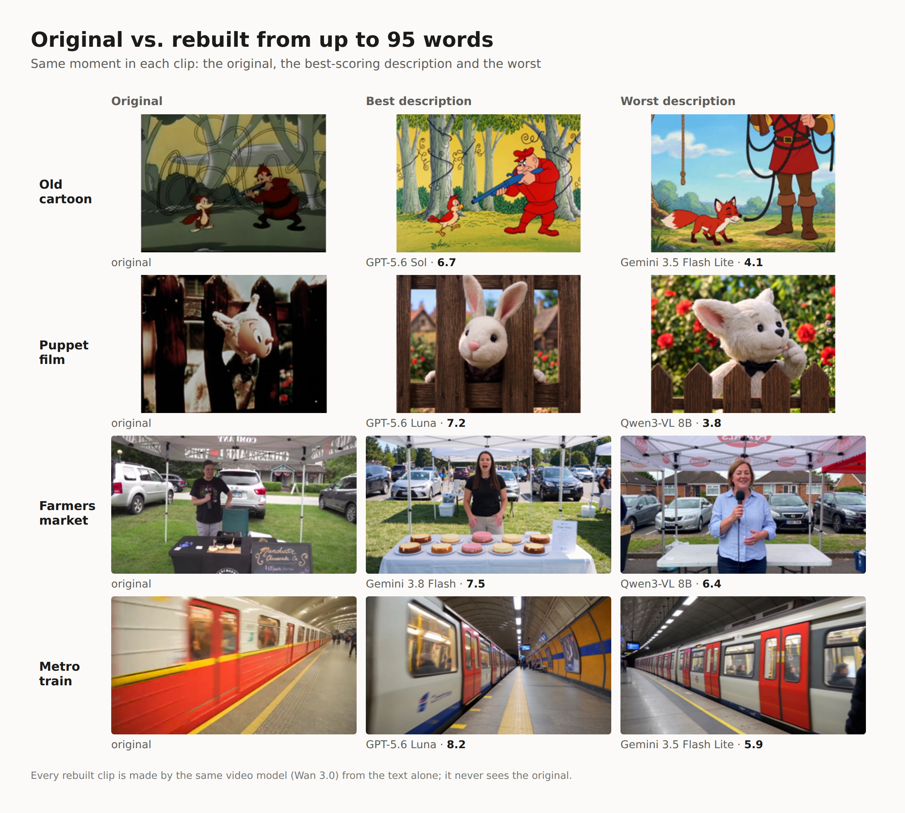

# Image Telephone: how well can AI describe an image or a video in words?

Two benchmarks for vision-language models: [paintings](#paintings) and
[video clips with sound](#video-clips-with-sound).

# Paintings

A benchmark for vision-language models. A model gets a painting and
describes it in **at most 40 words**. An image model redraws the painting
from that text alone. A judge model then scores the redraw against the
original on 8 visual metrics.

It works like lossy compression: a few hundred KB of image goes down to
40 words and is rebuilt from them. The question is which model keeps the
most information.



## Pipeline

```
painting ──▶ describer (vision LLM, ≤ 40 words, leak-checked)
         ──▶ renderer  (one fixed image model, text only)
         ──▶ judge     (Claude Opus 5.5, sees only the two images)
         ──▶ 8 scores, 0–10: composition · color · lighting · figures ·
                              poses · faces · setting & objects · style
```

All model calls go through the [OpenRouter](https://openrouter.ai) API.
The painting benchmark uses only the Python standard library. Describers
run in parallel, and every step is cached, so re-running a benchmark only
redoes what's missing.

## Results

Average over 9 little-known paintings (0–10, higher is better):

| Describer | Score | Score when told the grading criteria | Cost / painting |
|---|---|---|---|
| Grok 4.7 | 4.51 | **5.03** | $0.084 |
| Gemini 3.8 Flash | 4.79 | 4.93 | $0.082 |
| GPT-5.6 Sol | 4.62 | 4.90 | $0.081 |
| Gemini 3.5 Flash Lite | 4.51 | 4.67 | $0.076 |
| GPT-5.6 Luna | 4.46 | 4.54 | $0.077 |
| Qwen3-VL-8B | 3.93 | 3.92 | $0.076 |

Cost is the actual OpenRouter spend for the whole pipeline (describe,
render, judge), tracked on every API call.

**Takeaways**
- **Cheap models are close to the expensive ones.** Apart from the small
  Qwen model, everything sits within about half a point.
- **Telling the describer how it will be graded helps.** With the grading
  criteria in the prompt (`--informed`), every model except Qwen improved.
  Grok gained the most and moved from 4th to 1st.
- **The top three are effectively tied.** Each score comes from one
  description and one render per painting, so differences of about 0.1
  are within noise. See [Limitations](#limitations).

## Keeping the test honest

**The first attempt failed, and that shaped the design.** I started with
*Girl with a Pearl Earring*. The models cheated: they recognized the
painting and the image model drew it from memory, adding details that
were never in the description. The score was measuring what the models
remembered, not how well they described.

So I made these changes:

1. **Little-known paintings** (from the Art Institute of Chicago's public
   domain collection) replaced famous ones. The famous paintings are
   still in `paintings/` as the "before" case.
2. **Leak filter on every description.** Descriptions that name the
   artwork, artist, museum, art movement or era (per-painting banned
   terms plus global ones) are rejected and retried with feedback. So are
   descriptions over 40 words or cut off below 15.
3. **Memory-copy check.** The judge separately lists details in the redraw
   that match the original but were never in the text. This is reported
   for every render, but it doesn't change the score.
4. **The judge never sees the description**, only the two images. That
   way it can't favor a describer's writing style.
5. **The judge is not a contestant.** Claude Opus 5.5 grades, and no
   Claude model is among the describers.
6. **One fixed renderer for all describers**, so the description is the
   only thing that varies.

## Limitations

- **One sample per cell.** Each describer gets one description, one render
  and one judgment per painting. Repeated runs are needed to put error
  bars on the ranking.
- **One renderer.** The renderer is a Google model
  (`gemini-3.1-flash-lite-image`), which could in principle favor
  descriptions written by Gemini models. The results don't show a clear
  pattern (Gemini models placed 2nd and 4th). A second renderer from
  another provider would settle it; `eval_one.py` already supports one.
- **An LLM judge is not a human judge.** The scores are relative and
  consistent within this benchmark, not absolute.

## Running it

```bash
export OPENROUTER_API_KEY=...

# 6 describers on one painting (image track only)
python3 bench_one.py phaeton --image-only
python3 bench_one.py phaeton --image-only --informed   # describers see the grading criteria

# Combine results across paintings into one ranking + cost table
python3 aggregate.py phaeton fox_river heraclius ...
```

Results are written to `out/<painting>/`. Python 3.10+, no packages to
install. The optional SVG track (without `--image-only`) also has a text
model draw the description as SVG. It needs headless Chromium: set the
`CHROMIUM` env var to its path.

# Video clips with sound

The same idea, applied to 8-second clips with a soundtrack.



## Pipeline

```
clip ──▶ 6 labeled frames + audio notes (transcript, music, sound effects)
     ──▶ describer (≤ 95 words: 60 for the picture, 35 for the sound)
     ──▶ video model (Wan 3.0, text only) regenerates the clip with audio
     ──▶ judge (Gemini 3.1 Pro) watches and hears both clips
     ──▶ 13 scores, 0–10
```

- **Same input for every describer.** Each describer sees the same grid
  of 6 time-labeled frames and the same audio notes, so models that can't
  watch video or hear audio are on equal footing with those that can. The
  audio notes are written by Gemini 3.1 Pro, after loudness normalization.
- **One video model.** Every description is turned into a clip by Wan 3.0,
  so the description is the only thing that varies. Wan 3.0 was chosen
  after testing Grok Imagine Lite and Seedance 2.0 Mini on the same clip.
- **13 metrics.** There are 9 for the picture (composition, color,
  lighting, figures, setting, style, action, motion and camera, order of
  events) and 4 for the sound (speech, music, sound effects, sync).
- **Sound weight per clip.** The judge sets how much the sound counts in
  each clip, from 0% for a silent clip to 40% for one with speech and
  music. Sync counts half, since it's the roughest to judge. When the
  original has no music, the music metric is skipped instead of handing
  every recreation a free 10.

## Choosing and checking the judge

`judge_test.py` compares candidate judges on the same generated videos:
Claude Opus 5.5 on 6- and 12-frame grids, Gemini 3.1 Pro watching the
videos directly, and MiMo v2.6 Pro. Only Gemini caught near-still video and
missing lip sync, so it became the judge. It never sees the descriptions.

As a sanity check, Claude Opus 5.5 re-grades a fixed sample of about 20% of
the recreations from 12 frames and the audio notes.

## Results

| Describer | Basketball | Old cartoon | Puppet film | Farmers market | Metro train | Average |
|---|---|---|---|---|---|---|
| GPT-5.6 Sol | 6.8 | 6.7 | 6.8 | 6.7 | 8.1 | **7.03** |
| GPT-5.6 Luna | 6.6 | 5.4 | 7.2 | 6.7 | 8.2 | 6.81 |
| Gemini 3.8 Flash | 5.8 | 5.1 | 7.0 | 7.5 | 7.9 | 6.67 |
| Grok 4.7 | 6.4 | 4.4 | 4.5 | 7.1 | 8.1 | 6.09 |
| Gemini 3.5 Flash Lite | 6.6 | 4.1 | 5.3 | 6.4 | 5.9 | 5.66 |
| Qwen3-VL-8B | 3.8 | 4.6 | 3.8 | 6.4 | 7.8 | 5.28 |

About $0.40 per describer per clip, most of it for generating the video.
GPT-5.6 Sol ranked first and was the most consistent across clips. As with
the paintings, there is one run per cell, so close scores are within noise.



## Keeping it honest

- **Banned names per clip.** Titles, cast, character and studio names are
  rejected in descriptions, as with the paintings.
- **Recognition check.** Each describer is also asked, separately, whether
  it recognizes the film. A *Fight Club* clip was dropped from the results
  because 4 of the 6 describers recognized it.

## Running it

Needs `ffmpeg` (through the `imageio-ffmpeg` package) and Pillow:

```bash
pip install imageio-ffmpeg pillow
export OPENROUTER_API_KEY=...
python3 video_sound.py <film.mp4> <start_s> <duration_s> <clip_id>
python3 aggregate_video.py
```

The source clips aren't included in this repo.

## Files

| File | What it does |
|---|---|
| `eval_one.py` | Core pipeline: describe (with leak filter), render, judge, memory-copy check |
| `bench_one.py` | Runs all describers on one painting in parallel, with caching and per-step cost |
| `aggregate.py` | Cross-painting ranking, per-metric averages and cost. It averages only over paintings every model completed |
| `video_sound.py` | Video benchmark: frames, audio notes, describe, regenerate with Wan 3.0, judge, check judge |
| `video_pilot.py` | First video version (picture only, frame grids); also holds the helpers `video_sound.py` uses |
| `judge_test.py` | Compares candidate video judges on the same clips |
| `aggregate_video.py` | Ranking across clips, with picture and sound averages |
| `run_one.py`, `chain.py` | Early experiments: can a model *guess the painting* from the redraw, and how many describe→redraw hops until it can't ("broken telephone") |
| `paintings/` | Source images, all public domain |

Built with [Claude Code](https://claude.com/claude-code).
